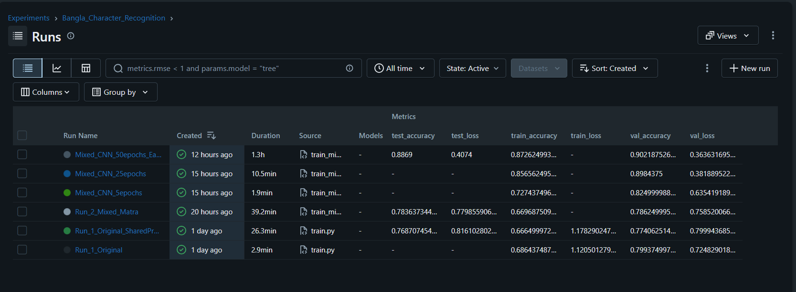
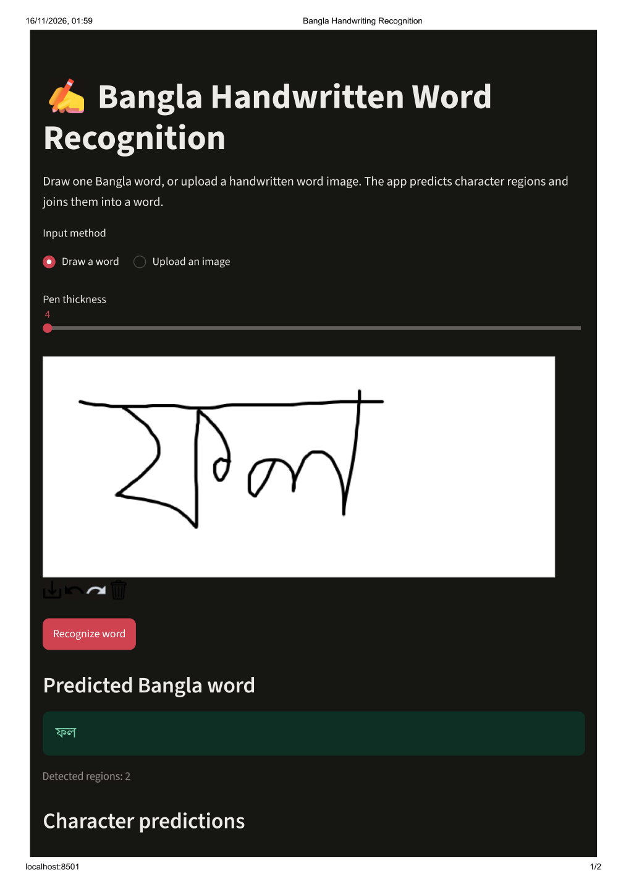

# Bangla Handwritten Word Recognition System

**Assignment:** 04 — Bangla Handwritten Word Recognition System  
**Student Name:** Nazifa Alam  
**Student ID:** 1000128863

## 1. Project Overview

This project is a Bangla handwritten word recognition system developed using Python, TensorFlow, and Streamlit.

The goal is to allow users to draw or upload a handwritten Bangla word and receive a complete predicted word.

I trained a custom Convolutional Neural Network (CNN) using the BanglaLekha-Isolated dataset, which contains individual handwritten characters rather than complete words. To process handwritten words, I implemented image preprocessing and character segmentation.

**Recognition pipeline:**

Handwritten word → Image preprocessing → Character segmentation → CNN classification → Predicted Bangla word

The application displays the complete predicted word, individual character predictions, and confidence scores. MLflow was used to track experiments, and Docker was used to package the application.

## 2. Dataset

**Dataset:** BanglaLekha-Isolated  
**Source:** [Mendeley Data](https://data.mendeley.com/datasets/hf6sf8zrkc/2)

The dataset contains:

- 166,105 handwritten character images.
- 84 character classes.
- Bangla vowels, consonants, digits, and selected conjunct characters.

Images are organized in numbered folders from 1 to 84. During training, these numbers are converted to class indices from 0 to 83. The character mapping is stored in `character_map.json`.

**Dataset split:**

| Split | Images |
|---|---:|
| Training | 132,884 |
| Validation | 16,610 |
| Testing | 16,611 |
| **Total** | **166,105** |

The dataset was split using stratified sampling with `random_state=42`.

The split was performed at image level rather than writer level. Images from the same writer may appear in different splits, so the test results do not establish performance on completely unseen writers.

The dataset is downloaded separately and is not included in the GitHub repository.

## 3. Tools and Libraries

| Tool | Purpose |
|---|---|
| Python 3.12 | Main programming language |
| TensorFlow / Keras | CNN training and prediction |
| NumPy | Numerical processing |
| OpenCV | Image processing and segmentation |
| Streamlit | Web application |
| Streamlit Drawable Canvas | Drawing handwritten words |
| MLflow | Experiment tracking |
| Scikit-learn | Dataset splitting and evaluation |
| Docker | Application packaging |
| VS Code | Development environment |

## 4. Image Preprocessing

Images are preprocessed before being passed to the CNN.

The main steps are:

1. Read and decode the image.
2. Convert it to grayscale where necessary.
3. Prepare white handwriting against a black background.
4. Crop around the handwriting.
5. Resize while maintaining the character's proportions.
6. Add padding to create a 48 × 48 image.
7. Normalize pixel values to the range 0–1.

These steps help standardize the input images.

### Matra: Problem and Experiments

Many Bangla characters are joined by a horizontal headline called the *matra*. This makes separating characters in handwritten words difficult.

I experimented with two related approaches:

**Matra-aware segmentation:** Detecting and temporarily removing parts of the headline to help identify individual character regions.

**Matra-removal augmentation:** Training the CNN with a mixture of original character images and images with parts of the headline removed.

The second approach was intended to help the CNN recognize characters when their headline was incomplete or modified.

### What did the experiments show?

The selected mixed CNN achieved **90.47% best validation accuracy** and **88.69% isolated-character test accuracy**. The complete pipeline correctly recognized **6 out of 10 handwritten development words**.

The initial three-epoch original-only and mixed-CNN experiments had similar character-classification results. In the limited word tests, matra-based methods did not resolve the main recognition difficulties. These findings do not establish that matra-removal augmentation improves whole-word recognition.

Matra-aware segmentation identified the expected number of regions in 8 out of 10 test words, but correct region counts did not always produce correct character predictions.

Overall, the matra-based methods had limited success and did not solve the main difficulties in complete-word recognition.

## 5. CNN Model

I developed a custom CNN for handwritten Bangla character classification.

### Model Architecture

| Layer | Description |
|---|---|
| Input | 48 × 48 grayscale image |
| Conv2D | 32 filters, 3 × 3, ReLU |
| MaxPooling2D | 2 × 2 |
| Conv2D | 64 filters, 3 × 3, ReLU |
| MaxPooling2D | 2 × 2 |
| Conv2D | 128 filters, 3 × 3, ReLU |
| MaxPooling2D | 2 × 2 |
| Flatten | Converts feature maps into a vector |
| Dense | 256 neurons, ReLU |
| Dropout | 0.4 |
| Output | 84 neurons, Softmax |

**Total trainable and non-trainable parameters:** 1,294,164.

The convolutional layers learn visual features such as strokes, curves, and character shapes. The final layer produces a probability distribution over 84 character classes.

### Training Settings

| Setting | Value |
|---|---|
| Optimizer | Adam |
| Learning rate | 0.001 |
| Batch size | 32 |
| Loss function | Sparse categorical cross-entropy |
| Metric | Classification accuracy |
| Maximum epochs (longest experiment) | 50 |
| EarlyStopping patience | 8 |
| Checkpoint monitoring | Validation accuracy |

The longer mixed-CNN experiment used ModelCheckpoint and EarlyStopping to preserve the best-performing weights.

## 6. Training Experiments and MLflow

I trained different CNN configurations to investigate training duration and matra-removal augmentation. MLflow was used to record experiment settings and performance metrics.

### Experiment Results

| Experiment | Validation accuracy | Test accuracy |
|---|---:|---:|
| Original CNN — 3 epochs | 77.41% | 76.87% |
| Mixed CNN — 3 epochs | 78.62% | 78.36% |
| Mixed CNN — 5 epochs | 82.50% | Not evaluated |
| Mixed CNN — 25 epochs | 89.84% | Not evaluated |
| Mixed CNN — 50 maximum epochs | **90.47%** | **88.69%** |

The selected mixed-CNN experiment stopped after **41 epochs** using EarlyStopping. Its best checkpoint was saved at **epoch 33**, achieving **90.47% validation accuracy**. The approximately **90.22%** shown for epoch 41 in MLflow represents the final logged epoch, not the best saved checkpoint.

### Selected Model Results

- **Best validation accuracy:** 90.47%
- **Held-out character test accuracy:** 88.69%
- **Held-out test loss:** 0.4074

The final checkpoint is stored at `models/model.keras`.

These results measure isolated-character classification, not complete-word recognition.

### Experimental Findings

Longer training was associated with substantial improvements in character classification accuracy.

Matra-removal augmentation did not demonstrate a clear improvement in complete-word recognition in the limited comparison performed.

The experiments used different training durations and numbers of batches per epoch, so their results cannot isolate the effect of augmentation alone.

### Training and Logging Limitations

During development:

- Some MLflow run names were corrected.
- Some earlier runs did not record training loss.
- The original long-training script encountered a history-processing error after the best checkpoint had already been saved.
- Some training epochs processed fewer batches because the dataset was not repeated.
- Validation during training was limited to a subset rather than the entire validation dataset.

The selected checkpoint was subsequently evaluated on the full held-out test split.

### MLflow Screenshot



To inspect the local MLflow database:

```bash
python -m mlflow ui --backend-store-uri sqlite:///mlflow.db --host 127.0.0.1 --port 5000
```

Open `http://localhost:5000`.

The historical MLflow database is kept locally and is not included in the GitHub repository.

## 7. Handwritten Word Segmentation

BanglaLekha-Isolated contains individual characters, while the application accepts complete handwritten words. The current CNN classifies isolated characters, so a segmentation stage is used to extract character regions from the word image.

### Segmentation Process

1. Read the handwritten word.
2. Convert it to a binary image.
3. Estimate the horizontal headline.
4. Temporarily remove parts of the headline to separate connected regions.
5. Identify candidate character regions.
6. Extract and preprocess the regions.
7. Pass them to the CNN.
8. Join the predicted characters.

### Segmentation Testing

The algorithm produced the expected number of regions in **8 out of 10 handwritten development samples**.

However, this did not consistently produce correct word predictions. The approach sometimes removed useful character strokes or failed to preserve vowel signs and connected components.

**Conclusion:** Matra-aware segmentation was useful for identifying some character boundaries, but its overall effectiveness was limited. It should not be interpreted as a reliable solution to Bangla word segmentation.

The ten samples were also used during development, so they do not constitute an independent segmentation benchmark.

## 8. Complete-Word Prediction

The application combines character predictions into a single output string.

**Example:**

Input: জল  
Predicted characters: জ + ল  
Predicted word: **জল**

The output includes both the predicted word and information about the individual characters.

### Word Recognition Testing

The selected mixed CNN correctly recognized **6 out of 10 handwritten development words**.

| Actual word | Recognition result |
|---|---|
| বল | Correct |
| ফল | Correct |
| জল | Correct |
| কলা | Incorrect |
| কলম | Correct |
| কমল | Correct |
| মালা | Incorrect |
| মানুষ | Incorrect |
| নাম | Incorrect |
| নকল | Correct |

**Exact-word accuracy on these ten samples: 60%.**

The incorrect words contained dependent vowel signs, which the model does not classify separately. The small development test does not provide a reliable estimate of general word-recognition accuracy.

The application currently joins raw CNN predictions without dictionary-based spelling correction or a language model.

## 9. Streamlit Application

The Streamlit application allows users to:

- Draw handwritten Bangla words.
- Adjust pen thickness.
- Upload PNG or JPG images.
- Request a word prediction.
- View the complete predicted word.
- View individual character predictions and confidence scores.
- Receive messages for missing or invalid input.

### Application Screenshot



### Running Locally

Create and activate a virtual environment:

```powershell
py -3.12 -m venv .venv
.\.venv\Scripts\Activate.ps1
```

Install the application dependencies:

```bash
python -m pip install -r requirements.txt
```

Start Streamlit:

```bash
python -m streamlit run app.py
```

Open `http://localhost:8501`.

### Training the CNN

Install the training dependencies:

```bash
python -m pip install -r requirements-train.txt
```

Download BanglaLekha-Isolated and place its character folders under `data/BanglaLekha-Isolated/Images/`.

**Mixed CNN training (default):**

```bash
python train.py
```

This launches the mixed-CNN training implementation with a maximum of 50 epochs, checkpointing, and EarlyStopping.

**Original-only baseline:**

```bash
python train.py --baseline
```

This launches the original 3-epoch baseline experiment. Both approaches use MLflow for experiment tracking.

The submitted checkpoint, `models/model.keras`, was produced by an earlier mixed-training experiment. The current `train_mixed.py` is a cleaned implementation of that training approach, with safer checkpoint handling and improved metric logging.

New mixed-training runs save their models separately under `experimental_runs/`. They do not automatically replace `models/model.keras`.

Because augmentation and training involve randomness, rerunning the training scripts is not guaranteed to reproduce exactly the original model weights or reported accuracy.

### Evaluating the Submitted Model

To evaluate the existing checkpoint without retraining:

```bash
python evaluate.py
```

This evaluates `models/model.keras` against the held-out character test split and prints accuracy and loss. The BanglaLekha-Isolated dataset and dependencies in `requirements-train.txt` are required for evaluation.

## 10. Docker Deployment

Docker was used to package the application and its dependencies into a Linux container.

### Build the Docker Image

Start Docker Desktop, then run from the project directory:

Run the Docker build command from the project root directory, ensuring that models/model.keras is present. The Docker image requires this trained checkpoint for inference.

```bash
docker build -t bangla-ocr-app:0.2 .
```

### Run the Container

```bash
docker run --rm -p 8501:8501 bangla-ocr-app:0.2
```

Open `http://localhost:8501`.

The updated Docker application was tested after moving the checkpoint to `models/model.keras`.

The Docker container uses the application dependencies from `requirements.txt`, while training-specific dependencies are listed separately in `requirements-train.txt`.

## 11. Project Files

```text
assignment_4/
├── app.py
├── train.py
├── train_mixed.py
├── predict_word.py
├── segment_word.py
├── utils.py
├── evaluate.py
├── character_map.json
├── models/
│   └── model.keras
├── requirements.txt
├── requirements-train.txt
├── Dockerfile
├── .dockerignore
├── .gitignore
├── README.md
└── screenshots/
    ├── streamlit_app.png
    └── mlflow_experiment.png
```

The training dataset, local Python environment, experimental checkpoints, MLflow database, and temporary debug files are excluded from the GitHub repository.

Older training scripts, logs, checkpoints, and experiments are preserved separately for development records.

The submitted model is retained in `models/model.keras`, and both the Streamlit application and Docker configuration reference this location.

## 12. Limitations

### Dependent Vowel Signs

The dataset includes independent vowels such as অ, আ, and ই, but the current 84-class CNN does not separately classify dependent vowel signs such as া, ি, and ু.

This limits the system's ability to correctly reconstruct words such as কলা, মালা, and মানুষ.

### Matra Segmentation

Removing the connected headline sometimes helps identify character regions but may also erase useful strokes. The segmentation approach did not provide consistently accurate whole-word recognition.

### Matra Augmentation

Matra-removal augmentation was explored, but its contribution to whole-word recognition was not established. The available experiments and small handwritten-word test set are insufficient to isolate its effect.

### Conjunct Characters

Certain conjunct characters and unusual handwriting styles are difficult to separate or classify.

### Unseen Handwriting

The dataset was split at image level rather than writer level. Performance on entirely unseen writers may differ.

### Limited Word Testing

Only ten handwritten development words were evaluated. The results are insufficient for estimating general word-recognition accuracy.

### No Spelling Correction

The application displays raw CNN predictions without dictionary-based correction or a language model.

## 13. Problems Faced and Solutions

| Problem | Approach |
|---|---|
| Connected Bangla characters | Developed matra-aware segmentation |
| Different character sizes | Used cropping, resizing, and padding |
| Limited initial accuracy | Trained and compared multiple CNN configurations |
| Training stopped before 50 epochs | Preserved the best checkpoint using EarlyStopping |
| Training-history logging error | Retained the checkpoint and evaluated it separately |
| Incorrect word predictions | Tested segmentation and documented vowel-sign limitations |
| Canvas compatibility | Used `streamlit-drawable-canvas==0.9.3` |
| Docker setup | Packaged and tested the application in a container |
| Large number of experiment files | Archived experimental scripts and checkpoints |

## 14. Future Improvements

Possible improvements include:

- Training on a dataset containing complete handwritten Bangla words.
- Using sequence-recognition architectures such as CRNN with CTC loss.
- Improving handling of dependent vowel signs.
- Developing more reliable character segmentation.
- Comparing segmentation-based and segmentation-free recognition.
- Adding optional dictionary-based spelling suggestions.
- Testing on more words and completely unseen writers.
- Improving experiment reproducibility and dataset-split management.

These improvements are not implemented in the submitted version.

## 15. Conclusion

This project combines CNN-based Bangla character recognition, image preprocessing, character segmentation, and a Streamlit application.

The selected CNN achieved **88.69% accuracy** on the held-out isolated-character test set.

The complete system correctly recognized **6 out of 10 handwritten development words**, demonstrating both its ability to predict complete words and its current limitations.

Matra-aware preprocessing and segmentation were explored, but they did not consistently improve whole-word recognition.

The main challenge remains accurately recognizing connected handwriting and dependent vowel signs using a model trained on isolated characters.

The project demonstrates a functioning recognition pipeline while identifying areas where a word-level recognition model could provide improvements.

## 16. References

- [BanglaLekha-Isolated — Mendeley Data](https://data.mendeley.com/datasets/hf6sf8zrkc/2)
- [TensorFlow Documentation](https://www.tensorflow.org/)
- [Streamlit Documentation](https://docs.streamlit.io/)
- [MLflow Documentation](https://mlflow.org/docs/latest/)
- [Docker Documentation](https://docs.docker.com/)

**Character mapping source:** The character-to-class mapping in `character_map.json` was obtained from the [Bangla-OCR community repository](https://github.com/Tausifislam01/Bangla-OCR/blob/main/character_map.json) and cross-checked against [another community implementation](https://github.com/b14z31ng/bangla_ocr/blob/main/charechter_map.json).

I verified the dataset's 84-folder structure and checked selected class mappings, including ক, জ, ম, and ল. However, the complete mapping was not independently verified against an official class chart.
